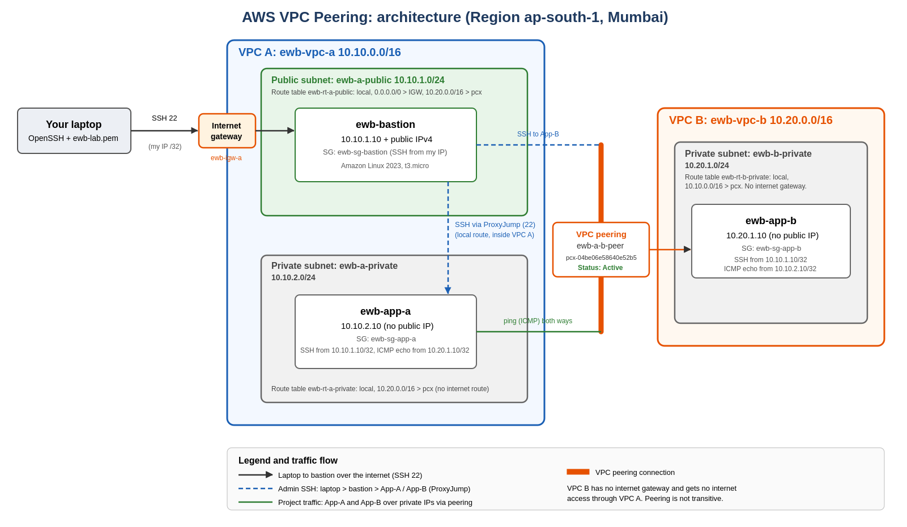

# AWS VPC Peering: Connect Two VPCs and Prove Private Connectivity

**Name:** Nithin N.
**Batch:** AWS Internship Batch 1
**Organisation:** EWB EDUTECH Private Limited, AWS Cloud Computing Internship (via AICTE)
**Project:** Project 01 / Oct 2026, EWB Cloud Labs: VPC Peering
**Region:** Asia Pacific (Mumbai), ap-south-1
**Completed:** 23 October 2026

## Summary

Two private VPCs were connected with a VPC peering connection so that two application servers could talk to each other over private IPv4 addresses only. One public bastion host in VPC A is the only entry point for administration, and neither application server has a public IP address.

| Resource | CIDR / address |
|---|---|
| VPC A (`ewb-vpc-a`) | 10.10.0.0/16 |
| Public subnet A (`ewb-a-public`) | 10.10.1.0/24 |
| Private subnet A (`ewb-a-private`) | 10.10.2.0/24 |
| VPC B (`ewb-vpc-b`) | 10.20.0.0/16 |
| Private subnet B (`ewb-b-private`) | 10.20.1.0/24 |
| Bastion (`ewb-bastion`) | 10.10.1.10 + public IPv4 |
| App-A (`ewb-app-a`) | 10.10.2.10, no public IP |
| App-B (`ewb-app-b`) | 10.20.1.10, no public IP |

AWS services used: VPC, subnets, route tables, internet gateway, security groups, EC2, key pairs, VPC peering.

## Architecture

## What was demonstrated

1. **Baseline failure:** App-A could not ping App-B before the peering routes existed.
2. **Peering and routes:** peering connection `ewb-a-b-peer` created, accepted and Active, with routes added on both sides (including the return route).
3. **Forward and reverse ping:** App-A to App-B and App-B to App-A, both successful over private IPs.
4. **Private SSH:** App-B reached from the laptop through the bastion using SSH ProxyJump, with no keys copied to any server.
5. **Controlled failure:** the ICMP Echo request rule was removed from the App-B security group, the ping failed, the exact rule was restored, and the ping recovered.
6. **Cleanup:** all resources were deleted and verified.

## Repository contents

| Path | Contents |
|---|---|
| `docs/Nithin_N_EWB_VPC_Peering.pdf` | Full project report |
| `docs/architecture-diagram.png` | Architecture diagram |
| `screenshots/` | Numbered screenshots (01 to 28), each labelled with the host, test and result in the report |

## Report

[Open the full report (PDF)](docs/Nithin_N_EWB_VPC_Peering.pdf)

## Notes

- The private key (`.pem`) is intentionally **not** included in this repository.
- All AWS resources were created only for this lab and have been deleted. Resource IDs in the report are for reference only.
